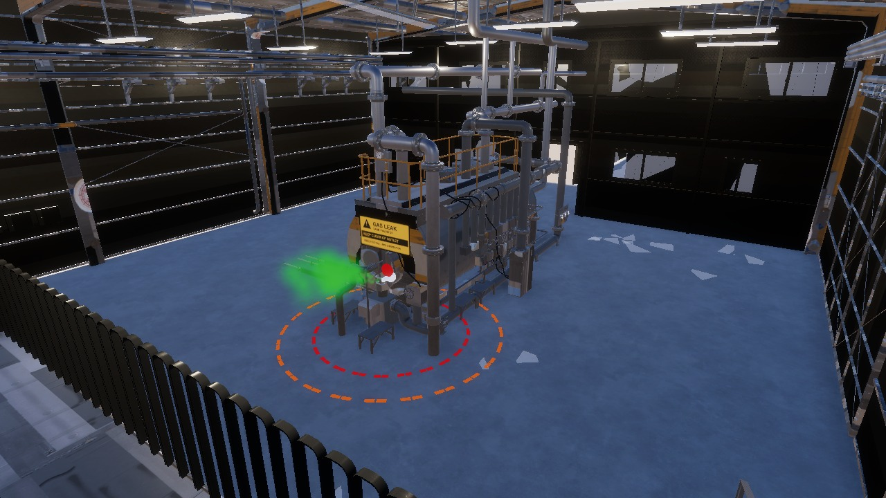

# 가스탱크 누출 맵

기존 `Assets/Scenes/Plant_Inspection.unity`에 탱크 누출 구역을 추가했다. 제공한 `sample_robot.mp4`의 24~28초에 나오는 설비 점검과 녹색 누출 효과를 참고했다. 영상 전체를 정확히 복제한 지형은 아니다.

## 사용한 제공 에셋

| Modeling 폴더의 패키지 | Unity 에셋 / 용도 |
|---|---|
| `object/fac_gastank.unitypackage` | `Assets/object/fac_gastank_1.prefab`: 기존 탱크·배관·원본 계기판 3개 |
| `effect/gas_spurt.unitypackage` | `Assets/effect/gas_spurt_1.prefab`: 밸브에서 분출하는 녹색 파티클 |
| `map/factory_inner_1.unitypackage` | `Assets/Map/factory_inner_1.prefab`: 공장 내부 |

실제 Unity 프로젝트에 이미 들어 있는 에셋이 제공 패키지의 파일과 같은지 확인하고 재사용했다. 제공 원본 에셋은 저장소에 중복 저장하지 않는다. 다른 PC에서는 원본 패키지를 먼저 가져온 뒤 `unity/`의 추가 파일과 `.meta`를 `Assets/` 아래 같은 경로에 복사한다.

## 배치와 연결

- `03_Factory_Equipment/fac_gastank_1/09_Gas_Tank_Leak_Zone`에 누출 구역을 배치했다. 원래 계기판 3개와 95°C 점검 설정을 유지한다.
- 탱크 동쪽 벽을 메시 Raycast로 찾고 플랜지·밸브·분출 효과를 붙였다. 누출 기준점은 Unity 월드 좌표 약 `(16.189, 1.3, 1.0)`이다. 기존 바닥의 녹색 센서 구체는 제거했다.
- 같은 기준점을 `Spot_Robot > UnityPlantInspection > Gas Source`에 연결했다. 최고 농도 120ppm, 수평 가우시안 표준편차 1.25m인 가상 농도장이다. 파티클은 이를 알아보기 쉽게 표현한 시각 효과다.
- 바닥의 빨간 점선은 50ppm 경계(반경 약 1.65m), 주황 점선은 20ppm 경계(약 2.37m)다. 현재 데모 설정에서 계산한 경계이며 실제 산업안전 구역이 아니다.
- 계기판·열화상 점검 후 `Machine_East → Gas_Leak_Approach`로 이동한다. 탱크의 충돌 메시를 피하는 접근·이탈 경로를 생성한다. 농도 또는 누적 노출 경보가 발생하면 ROS가 정지 후 이미 통과한 경로로 복귀한다.

농도는 거리로 계산하는 합성 데이터이며 실제 가스의 유체 확산·바람·차폐를 계산하지 않는다. 녹색 표현도 시연용이다.

## 실행과 재생성

1. Docker Desktop을 켜고 저장소 루트에서 `docker compose -f unity/compose.yaml --profile inspection up -d --build`를 실행한다.
2. Unity에서 `Assets/Scenes/Plant_Inspection.unity`를 열고 Play한다. ROS가 이동·점검·가스 경보·복귀를 제어한다.
3. 구역만 다시 만들려면 Play를 중지하고 **Doosan → ROS 2 → Add Gas Tank Leak Map**을 실행한다. 이 메뉴는 점검 씬의 누출 구역과 경로를 덮어쓴다. 직접 수정한 씬은 다른 이름으로 저장한다.
4. 생성된 `Assets/DoosanReference/inspection_route.json`을 저장소 `unity/config/inspection_route.json`에 복사하고, 재생이 중지된 상태에서 `docker compose -f unity/compose.yaml restart inspection`을 실행한다.

**Create Inspection Scene** 메뉴에도 누출 구역 생성이 연결되어 있다. **Preview Gas Tank Map**은 재생 없이 `Logs/GasTankMap.png`, `Logs/GasTankLeak.png`에 실제 Unity 렌더링을 저장한다.

**Show Gas Tank Map** 메뉴로 Scene 뷰에서 누출 지점으로 바로 이동할 수 있다.

복귀 시 시작점 4m 이내에서는 최대 0.35m/s로 접근한다. 시작점 0.15m 이내에서 실제 이동 속도가 0.05m/s 미만인 상태를 시뮬레이션 시간 2초간 관측한 뒤 완료로 판정한다. 완료 후 위치가 0.2m 밖으로 벗어나면 다시 보정한다. 순찰 중 순항 속도 1.7m/s는 유지한다. 관련 회귀 검사 7개는 ROS 환경을 불러온 뒤 `python3 /workspace/unity-tools/test_patrol_home.py`로 실행한다.

실제 Unity–ROS 연결에서 계기판 3개 판독, 95°C 온도, 약 53.36ppm 최초 경보, 역경로 복귀, 홈 오차 약 0.147m와 정지를 확인했다. 전체 관측 검사 9개가 통과했으며 결과는 `docs/validation/unity-gas-map-integration.json`에 있다. 센서 데이터가 잠깐 끊긴 구간에는 정지 후 신선한 데이터가 도착하면 재개했다.

생성 코드는 `Editor/DoosanGasMapSetup.cs`, 재질·안내판·파티클 텍스처는 `DoosanReference/GasLeak/`, 배치 기록은 `docs/validation/unity-gas-map-layout.json`에 있다. 전체 연결 검사는 기존 `tools/verify_inspection.py`로 관측하며 이동 명령은 추가로 발행하지 않는다.
